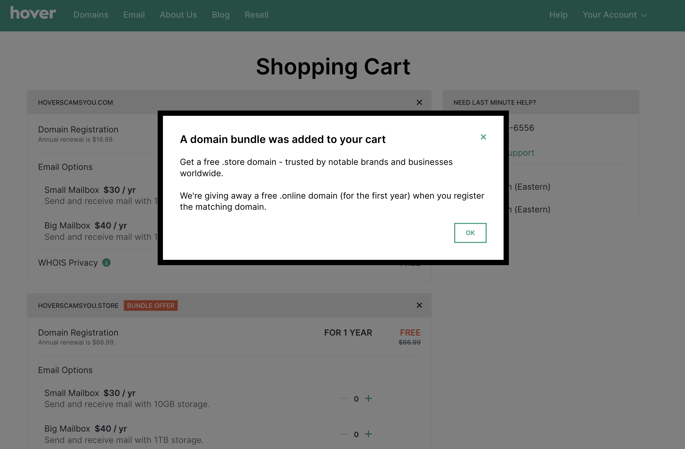
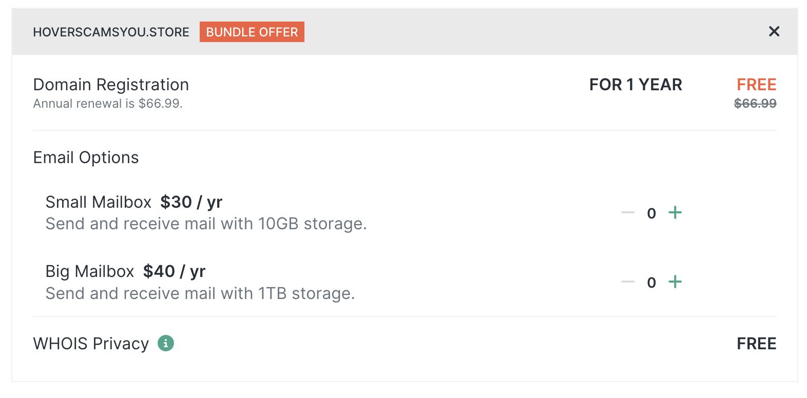

When you buy certain domains on Hover.com, the Hover website will helpfully throw in a "free" domain at checkout. These domains are always something along the
lines of "yourdomain.site", "yourdomain.store" or "yourdomain.online". The first time I saw this I thought "great! I like free things". Never mind that
I never wanted or needed a `.store` domain.

The popup helpfully lets you know that you're getting a free domain for the first year. What it doesn't let you know is how much you'll be paying for the
the domain for every year after the first one! The only point of this popup is to prime you into thinking that you're getting something for free so that
you don't look too closely when you checkout.

If you're an impatient fool like me, you'll never notice the crossed out $69.99 or the tiny gray text telling you that that your "free" domain is going
to cost you $69.99. At this point you've already been primed to think that you're getting something for free, so you'll see the all caps, visibly colored
"FREE" label and move on with your day. You'll most likely click checkout, not realizing that you've accidentally just purchased a domain that you don't
want for a whopping ***3.6 times*** the price of the domain you actually wanted.

This is a masterclass in dark patterns because they never lie to you. The information is all there. It's just presented in a way that you never think
too hard about it. Domain registrations are also the perfect place to pull this stunt. Most people will buy a domain, set it up and forget about it.
Many won't notice or think twice about the credit card charge a year later.

Now I'm not an idiot (though this experience has made me think twice about that). I always double check the fine print on these things because I'm used
to companies pulling this shit, especially internet and cellular providers. Despite all of this, Hover still managed to con me four times before I caught
on. All of this is especially disappointing because I've been a very happy Hover customer for the past 10 years. Needless to say, I am moving all of
my business elsewhere after this experience. Hover may have scammed a few hundred dollars out of my wallet, but in the process they lost $7,200 in
revenue over the next 20 or so years.
